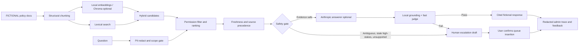

# RAG-Based Immigration Visa Policy Assistant

A portfolio prototype demonstrating a permission-aware, safety-gated policy assistant. **All people, employee IDs, case IDs, documents, rules, and policy scenarios in this repository are synthetic. This application is not legal advice and does not provide current USCIS or immigration guidance.** Real-world legal and policy questions are routed to a human rather than answered from invented material.

## Problem and user

In the case-study scenario, H-1B and L-1 employees in their first two US years ask a small number of policy questions each quarter. A thin immigration team can take days to answer even a narrow form question. This prototype explores how a documented, permission-aware assistant might answer low-risk, well-supported questions immediately while routing uncertainty and high-impact questions for human review.

The current prototype intentionally does not serve real employees or resolve real immigration questions. Its policy corpus is entirely fictional.

## Why RAG, and why an agent

RAG makes the evidence visible and versioned: an answer can be tied to a specific synthetic passage, section, date, and access group. Prompting alone does not provide a controlled, inspectable source set; fine-tuning is a poor fit for fast-changing, permission-bound policy documents.

The agent layer chooses among retrieval, profile lookup, deadline calculation, form-field lookup, freshness checks, and escalation drafting. The deterministic safety spine decides whether the model may be called and whether a candidate response may be shown. A hard case is routed to a human, never to a larger model.

## Architecture



Permission filtering happens before candidates reach reranking, model context, citations, or escalation findings. Employee mode is bound to one synthetic profile; team and admin roles are demonstration-only role switches, not authentication.

## Stack and run

- Python 3.11 or newer; project environment currently verified on Python 3.14.7
- Streamlit UI and pytest suite
- ChromaDB plus SentenceTransformer are optional; local dense retrieval requires a pre-existing local model directory and never downloads a model automatically
- Anthropic SDK is optional; API calls require explicit live-mode enablement and configured model IDs

```sh
python -m venv .venv
source .venv/bin/activate
python -m pip install -e '.[test]'
streamlit run app.py
```

Run the deterministic golden set with:

```sh
python scripts/run_evaluation.py
```

Enable Anthropic mode by installing `python -m pip install -e '.[model]'`, copying `.env.example` to `.env`, and setting `ANTHROPIC_API_KEY`, `ANTHROPIC_MAIN_MODEL`, and `ANTHROPIC_FAST_MODEL` to values available to your account. Never commit `.env` or paste credentials into chat. Live API requests were not tested in this workspace because no API key is configured.

Optional offline embeddings can be configured with `POLICY_EMBEDDING_MODEL` pointing to an already-downloaded local model and `POLICY_CHROMA_PATH` for persistence. Without it, retrieval remains lexical.

## Synthetic corpus and permissions

`data/employees.json` contains 15 invented employee profiles with synthetic names and IDs, department, H-1B/L-1 category, expiry, extension state, spouse category, US start date, and access groups. `data/policy_documents.json` contains 20 clearly labeled fictional company-policy and USCIS-style documents.

The fixtures include old documents, a two-version document, a listed-but-unloaded newer version, restricted company-only material, and an exception stored in a separate structural section but kept with its rule during chunking. Company policy is preferred for internal process; fictional USCIS-style material is preferred for underlying demo scenarios. The access-group selector and role switcher simulate authorization behavior only.

## Agent tools and autonomy

Implemented tools include permission-filtered `search_policy`, own-profile `get_my_profile`, `check_deadline`, `explain_form_field`, freshness/version checks, escalation draft creation, and explicit queue confirmation. `detect_and_redact_pii` runs before query classification or retrieval.

The agent may return only a relevant, permitted, current-enough fictional passage with citation. It asks one clarifying question for vague prompts. It refuses real-world law, personal recommendations, and outcome predictions. Missing/conflicting evidence, stale or lagging high-stakes sources, and failed grounding go to human review. Escalation produces a draft; a user confirmation is required before the queue is changed. Email is never sent.

Anthropic live mode is optional at runtime and disabled by default. When enabled, the main model gets only the redacted question and permission-filtered synthetic passages; the fast model judges grounding. Deterministic scope checks and local claim grounding remain in front of the fast judge, so a model judge cannot make an unsupported claim acceptable.

## Safety and failure modes

- **Bad or stale source data:** compare loaded version with a latest-known manifest; old or lagging high-stakes evidence routes to a human.
- **Rules split from exceptions:** chunk by document structure and retain all sections for the rule; golden tests assert the exception travels with the rule.
- **Retrieval misses or noise:** combine lexical and optional local dense candidates, filter permissions before reranking, apply a relevance floor, and escalate when no candidate clears it. Current context precision shows this remains an improvement area.
- **Unsupported claims:** every extractive answer is checked against evidence; optional model output also gets deterministic grounding and a fast-model judge. Failure escalates without exposing the candidate answer.
- **Silent knowledge staleness:** compare `last_updated` and loaded version to the manifest; display warnings and route high-stakes stale requests.
- **Misuse:** redact PII before retrieval/logging, ignore prompt injection, clarify vague prompts, and route personal-case advice and outcomes.
- **Permission leakage:** metadata group checks run at retrieval time and results/citations/escalation findings are bounded to permitted chunks.

## Observability and cost

Admin-only traces store the redacted question, permitted passages and rank, context sent to a live model, answer, gate decision, model usage, and estimated cost. `TRACE_RETENTION_DAYS` controls retention. Feedback records redact identifiers; promotion to the golden set requires an explicit checkbox confirmation. Traces are local prototype files, not a production security boundary.

Prompt caching marks stable system prompts as cacheable. The dated report uses a deliberately illustrative scenario: 4,000 main input tokens, 500 main output tokens, 250 fast-gate input tokens, and 40 gate output tokens with example prices in `.env.example`. It estimates **$0.0196/query uncached** and **$0.0088/query with a 90% discount on input tokens**, against the **$0.010 target**. These are assumptions, not measured API billing; actual cache eligibility, prices, and token use vary. No before/after live cost has been observed.

## Evaluation results

The deterministic synthetic golden set has 30 cases, including the requested H-1B/L-1, spouse/dependent, travel, extension, form, exception, stale/version-lag, restricted, PII, injection, vague, refusal, and escalation categories. Results are saved to `eval_results/evaluation_2026-10-19.csv` and `eval_results/summary_2026-10-19.json`. Re-run to create a dated result for the current day. The evaluator reports decision accuracy, Context Precision, Context Recall, Recall@K, grounded-answer rate, escalation correctness, permission leaks, illustrative cost, and simulated rollout gates.

| Metric | 2026-10-19 result |
| --- | ---: |
| Decision accuracy | 100% |
| Context Precision | 100% |
| Context Recall | 100% |
| Recall@5 | 100% |
| Grounded-answer rate | 100% |
| Escalation correctness | 100% |
| Permission leaks | 0 |

The retrieval score now weights rarer terms more heavily, rewards document-title matches, ignores generic synthetic boilerplate, and trims low-confidence tail candidates. The 100% precision value is still measured on only 30 hand-authored synthetic cases; it is a regression metric, not evidence of broad real-world retrieval quality. These are deterministic checks against synthetic fixtures, not independent legal review, LLM-as-judge validation of actual legal claims, attorney-reviewed correctness, or production readiness. Full metrics are in the JSON report.

## Rollout simulation

The report simulates the requested gates, but a pass is not a release recommendation:

- **Internal alpha:** simulated pass for 100% grounded answers and zero permission leaks.
- **Closed beta:** simulated pass for 100% escalation correctness.
- **General availability:** simulated pass for at least 90% decision accuracy.

Real rollout would additionally require attorney-reviewed current source material, proof of status-safe behavior, real identity and authorization controls, privacy/security review, operational escalation coverage, and live measured evaluation. None is supplied by this demo.

## Known limitations

- The entire KB is fictional. No answer should be interpreted as current immigration policy or legal advice.
- The answer path is deterministic and extractive unless live mode is configured. Anthropic has not been exercised here because credentials are absent.
- Dense retrieval is optional and not configured in the running demo; lexical retrieval is active.
- The local grounding check is a conservative heuristic, not a formal entailment proof. The Anthropic judge is not independently validated.
- Role switching is not authentication; queues and usage ledger are session-local demo state. Trace files are not encrypted or hardened for production.
- Golden cases and evaluation expectations are synthetic. Metric passes cannot establish attorney correctness.
- Caching and cost savings are illustrative, not measured.
- The golden set is small and intentionally targeted; expand it with independently reviewed cases before using the reported 100% metrics as a general quality estimate.
